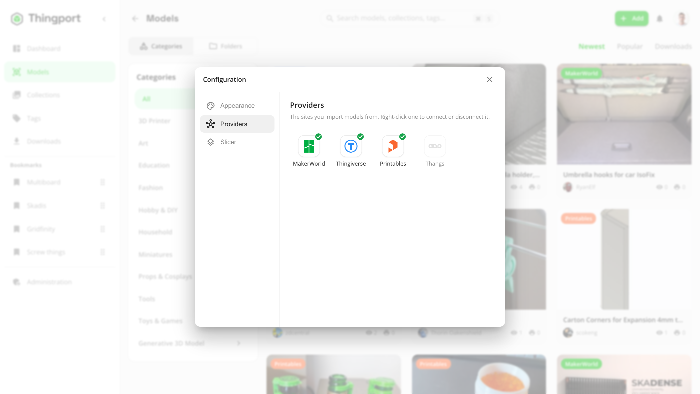

# Provider setup

Importing from **Printables** works out of the box (its public API needs no credential). **MakerWorld** needs each user's own session cookie, and **Thingiverse** an App Token an admin sets once for the whole instance. **MyMiniFactory** needs an API key an admin sets once for free models; each user connects their own MyMiniFactory session only to import paid or sign-in-only models from their library.

Connect them under **Configuration → Providers**: open the user menu (your avatar, top right) and choose **Configuration**, or click one of the provider chips at the bottom of that menu. Right-click a provider to connect or disconnect it, or double-click one that isn't connected yet. A green tick means it's connected. A provider your admin has [turned off](#turning-a-provider-off) isn't listed.

## Thingiverse App Token

Instance-wide, admin-configured (Configuration > Providers > Thingiverse, or Administration > Providers > Thingiverse App Token) -- one token is shared by every user's Thingiverse imports. Other users see Thingiverse as connected once an admin has set it up.

1. Sign in to your Thingiverse account, then go to [thingiverse.com/apps/create](https://www.thingiverse.com/apps/create).
2. Register a new app. The name/description don't matter for this; pick whichever Application Type doesn't require a redirect URL (e.g. "Desktop" or "Mobile") -- a "Web App" asks for OAuth details you don't need here.
3. Once created, Thingiverse shows an **App Token** for it. This is different from your Thingiverse login password -- it's a permanent credential tied to that registered app.
4. Copy it, right-click **Thingiverse** in Thingport's **Configuration > Providers**, choose **Connect** and paste it. Thingport verifies the token against Thingiverse before storing it, so a mistyped or revoked token is rejected immediately with a clear error instead of only failing on the next import.

Treat this token like a password: anyone who has it can use it to act as your Thingiverse app. If it's ever exposed, revoke it from your Thingiverse account's Apps page and generate a new one.

## MyMiniFactory API key

Instance-wide and admin-configured, like the Thingiverse token (Configuration > Providers > MyMiniFactory, or Administration > Providers > MyMiniFactory API key). Thingport uses it to read models' details, collections and authors; the files of free models download without it.

1. Sign in to your MyMiniFactory account, then go to [myminifactory.com/settings/developer](https://www.myminifactory.com/settings/developer).
2. Create an application. Its name doesn't matter.
3. Copy the application's **API key** -- not its client ID or client secret, which are for signing users in and won't work here.
4. Save it under **Administration > Providers > MyMiniFactory API key**. Thingport checks the key against MyMiniFactory before storing it.

With the key alone, free models import for everyone. **Paid models** you bought, and free ones whose files only download when signed in, come from your own MyMiniFactory library, so each user connects their MyMiniFactory account too.

## MyMiniFactory account

Per-user (Configuration > Providers > MyMiniFactory). Thingport downloads your bought and sign-in-only models as you, from your MyMiniFactory library, using your browser's MyMiniFactory session. Where MyMiniFactory has unpacked a model's archives, Thingport fetches just the model files from them, so RAR archives and very large zips are no problem.

### Easiest: Thingport Grab

With [Thingport Grab](../extension/README.md) allowed on MyMiniFactory, opening any myminifactory.com page while you're signed in connects your account, and keeps it connected as MyMiniFactory renews your session.

### Manual: copy it from your browser

1. Sign in at [myminifactory.com](https://www.myminifactory.com).
2. Open DevTools (`F12`, or `Cmd+Option+I` on macOS).
3. Chrome/Edge: **Application** tab > **Cookies** > `https://www.myminifactory.com`. Firefox: **Storage** tab > **Cookies**.
4. Copy the value of the cookie named `PHPSESSID`. (Pasting the whole `Cookie` request header works too: Thingport keeps only `PHPSESSID`.)
5. Right-click **MyMiniFactory** in Thingport's **Configuration > Providers**, choose **Connect** and paste it. Thingport checks it with MyMiniFactory before storing it.

This is your own MyMiniFactory login session -- don't share it. It expires once you sign out of MyMiniFactory, or after a while; Thingport then says so, and opening MyMiniFactory with Thingport Grab connects it again. A paid model you haven't bought can't be imported: Thingport Grab says so on its page.

## MakerWorld cookie

Per-user (Configuration > Providers > MakerWorld) -- MakerWorld has no developer API, so importing from it runs as _your own_ logged-in MakerWorld session, captured as a cookie value.

### Easiest: Thingport Grab

The [Thingport Grab](../extension/README.md) browser extension captures this automatically the first time you import something from a MakerWorld tab where you're already logged in -- there's nothing to copy by hand.

### Manual: copy it from your browser

1. Log in at [makerworld.com](https://makerworld.com) in your browser.
2. Open DevTools (`F12`, or `Cmd+Option+I` on macOS).
3. Chrome/Edge: go to the **Application** tab > **Cookies** > `https://makerworld.com`. Firefox: **Storage** tab > **Cookies** > `https://makerworld.com`.
4. Find the cookie named `token` and copy its **Value** column -- just that raw value, nothing else needs adding.
5. Right-click **MakerWorld** in Thingport's **Configuration > Providers**, choose **Connect** and paste it. Thingport verifies it against MakerWorld before storing it, so a stale or mistyped paste is rejected immediately instead of only failing on the next import.

If there's no cookie named `token` (MakerWorld occasionally renames things), use the **Network** tab instead: reload the page, click any request to `makerworld.com`, open its Request Headers, and copy the whole `cookie:` value. Thingport only pulls the `token=...` part out of it and ignores the rest, so pasting the entire header works too.

This is your own MakerWorld login session -- don't share it, and expect to redo this occasionally, since MakerWorld sessions eventually expire.

## Turning a provider off

Admins choose which providers this Thingport imports from, under **Administration → Providers**. All four are on by
default. Turn one off and nothing new comes from it for anyone: links to it, Thingport Grab and the import queue are
refused, its synced collections pause, and background jobs skip it. It also disappears from everyone's
**Configuration → Providers**. Models already imported from it stay as they are, and turning it back on picks up where
it left off. The Thingiverse App Token and the MyMiniFactory API key are set on the same page.
